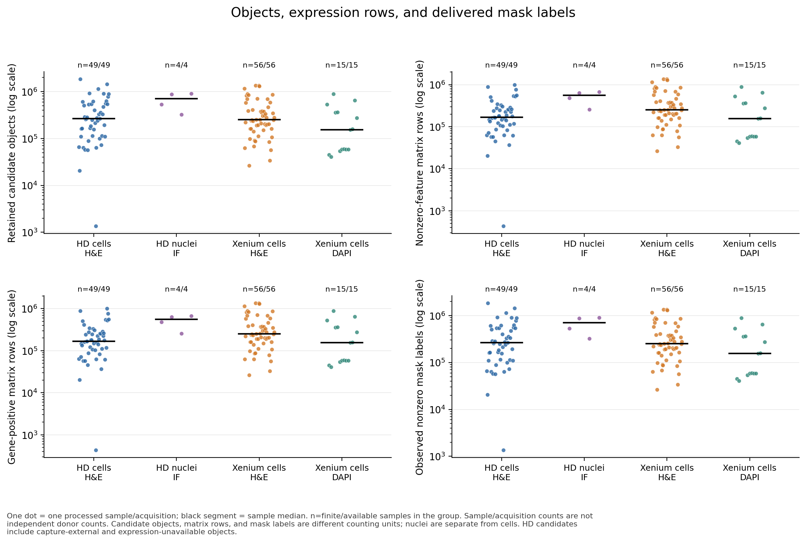

# The dataset

sMCC40M connects spatial molecular measurements to histology, cell or nuclear geometry,
spatial coordinates, acquisition metadata and source-backed biological context.
The [November 21, 2026 public release](https://huggingface.co/datasets/zhang-lab/sMCC40M/tree/7c0d215a4683e6f074177e708a192c416e2e2708) uses schema 2.0.0.

!!! note "About the name and the number"
    "40M" denotes the resource scale, not an exact count of whole cells. The exact
    gene-positive count in the public release is **48,652,230**. The NeurIPS paper also
    reports 53,989 observations from 21 in-house samples; in-house additions are announced in
    [What's new](../updates/index.md) as they are released. The code repository keeps the
    historical URL `sMMC40M`, and some data-side files keep historical `smcc` / `sMMC` identifiers.

## One record per cell or nucleus

Each observation joins, by `sample_id` + `cell_id`:

| Layer | What you get | Where |
| --- | --- | --- |
| Expression | Raw non-negative integer counts (CSR) on the **original measured feature axis** | sample-level H5AD |
| Geometry | Centroid in selected-image pixels and µm, segmentation mask | cell index Parquet, `obsm/spatial`, `obsm/spatial_um`, OME-TIFF masks |
| Histology | Native-resolution H&E (or DAPI / IF) image and per-cell image eligibility | sample image, eligibility Parquet |
| Context | Tissue, reporting category, diagnosis, condition, age, sex, study, source link | `metadata/samples.parquet`, [original catalog CSV](https://github.com/aicb-ZhangLabs/sMMC40M/blob/main/data/sample_catalog.csv) |
| Provenance | Source URL, license notice, checksums, lineage | `provenance/`, `licensing/`, `SHA256SUMS` |

## Counts and denominators

| Quantity | Count | Meaning |
| --- | ---: | --- |
| Acquisitions | 156 | 58 Visium HD + 98 Xenium |
| Indexed candidates | 58,481,495 | Every segmentation / native candidate |
| Gene-positive observations | 48,652,230 | At least one positive Gene Expression count |
| Gene-positive whole cells | 46,611,077 | Visium HD and Xenium cell records |
| Gene-positive nuclei | 2,041,153 | HD IF branch; not additional cells |
| Eligible H&E cell pairs | 32,929,907 | Gene-positive, centroid and mask in the selected image |
| Complete 224 px H&E crops | 32,929,619 | Additional image-edge criterion |

| Platform | Acquisitions | Gene-positive observations |
| --- | ---: | ---: |
| Visium HD | 58 | 13,929,779 |
| Xenium | 98 | 34,722,451 |
| **Total** | **156** | **48,652,230** |

## Coverage

The original October 28 release used **23 harmonized reporting categories**, including
developmental, plant, whole-organism and xenograft labels. The table below describes that
original cohort. For current acquisition metadata, use the [sample index](download.md#pick-samples-first).

| Category | n | Category | n | Category | n |
| --- | ---: | --- | ---: | --- | ---: |
| Breast | 25 | Skin | 5 | Prostate | 2 |
| Brain | 17 | Liver | 4 | Heart | 2 |
| Lung | 13 | Bone | 4 | Whole Organism | 2 |
| Ovary | 10 | Lymph Node | 3 | Small Intestine | 1 |
| Colon | 9 | Embryo | 3 | Xenograft | 1 |
| Kidney | 8 | Tonsil | 6 | Arabidopsis | 1 |
| Pancreas | 6 | Head | 1 | Soybean | 1 |
| Cervix | 1 | Bone Marrow | 1 | | |

**7 source species:** human, mouse, rhesus macaque, rat, zebrafish, *Arabidopsis thaliana* and soybean.

**Stains:** 110 H&E, 32 DAPI and 14 IF acquisitions.

## Quality control

<figure markdown>

</figure>

The figure and repository links describe the original release. New acquisition packages provide their own QC and eligibility files. See also the [updated validation report](https://huggingface.co/datasets/zhang-lab/sMCC40M/blob/7c0d215a4683e6f074177e708a192c416e2e2708/validation.json).
[quality control notes](https://github.com/aicb-ZhangLabs/sMMC40M/blob/main/docs/quality_control.md) ·
[compact QC table](https://github.com/aicb-ZhangLabs/sMMC40M/blob/main/data/qc/sample_qc_compact.csv) ·
[gene panels](https://github.com/aicb-ZhangLabs/sMMC40M/blob/main/data/qc/sample_gene_panels.csv).

## Things to know before you analyze

- **Missing panel genes are unmeasured, not zero.** Use each acquisition’s measured feature axis and avoid a zero-filled global gene union. A shared `gene_table_id` means an identical measured axis.
- **Select Gene Expression explicitly** on Xenium; keep negative controls and other feature types separate.
- **HD UMIs and Xenium transcript counts are different measurement types.**
- **Acquisitions are not assumed to be independent donors.** Check source-material relationships in the release metadata.
- **Predicted HD cell types are evidence, not ground truth**, and sample tumor status is not a per-cell malignancy label.
- **Pixel sizes vary.** Native-pixel crop sizes and physical µm windows are different quantities.
