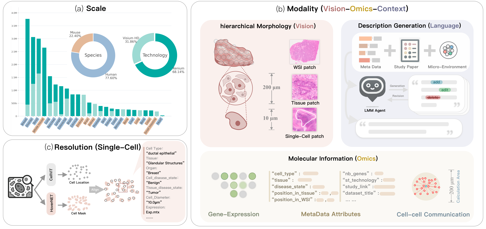

<div class="smcc-hero" markdown>
<p class="kicker">NeurIPS 2026 · Dataset &amp; benchmark</p>

# sMCC40M

<p class="lede">A context-aware dataset and benchmark for single-cell spatial transcriptomics.
It links expression, masks, coordinates and source-backed sample context across Visium HD
and Xenium, with H&amp;E crops available for eligible cells.</p>

<div class="chips"><span class="chip scale">SCALE</span><span class="chip res">RESOLUTION</span><span class="chip ctx">CONTEXT</span></div>

[Get the data](dataset/download.md){ .md-button .md-button--primary }
[Watch the talk](talk.md){ .md-button }
[Tutorials](tutorials/index.md){ .md-button }
[Benchmark](benchmark.md){ .md-button }
</div>

<div class="smcc-stats">
<div class="smcc-stat"><div class="n">48.65M</div><div class="l">gene-positive cell / nucleus observations</div></div>
<div class="smcc-stat"><div class="n">156</div><div class="l">acquisitions · 58 Visium HD + 98 Xenium</div></div>
<div class="smcc-stat rust"><div class="n">32.93M</div><div class="l">cells with an eligible H&amp;E pairing</div></div>
<div class="smcc-stat purple"><div class="n">7</div><div class="l">source species</div></div>
<div class="smcc-stat amber"><div class="n">CC BY 4.0</div><div class="l">with per-sample attribution</div></div>
</div>

## What's new

<!-- LATEST_UPDATES -->

[All updates →](updates/index.md)

<figure markdown>

<figcaption>Overview from the original release. The <a href="dataset/">dataset page</a> reports counts for the current release.</figcaption>
</figure>

## Why sMCC40M

Spot-level measurements average signals from multiple cells and can hide differences between them.
sMCC40M provides cell-resolution data and is organized around three axes.

<div class="grid cards" markdown>

-   :material-chart-bubble:{ .lg } **Scale**

    ---

    156 acquisitions across 7 species. The frozen benchmark provides matched protocols for comparing encoders and readouts.

-   :material-grid:{ .lg } **Resolution**

    ---

    An observation represents a cell or a nucleus. Visium HD 2 µm bins are assigned to a
    segmented object only when it covers **more than 50%** of the bin. Xenium keeps its native
    cell assignments.

-   :material-tag-multiple:{ .lg } **Context**

    ---

    Tissue, diagnosis, age, sex and study fields keep explicit *reported / not-reported / not-applicable*
    status, so failures can be stratified instead of averaged away.

</div>

## Start in five minutes

=== "Read one sample"

    ```bash
    pip install huggingface_hub anndata pyarrow
    export REPO=zhang-lab/sMCC40M
    hf download "$REPO" examples/download_sample.py --repo-type dataset --local-dir .
    python examples/download_sample.py --repo "$REPO" --platform HD --sample HD-002
    python smcc_data/HD/samples/HD-002/read_example.py
    ```

=== "Try the benchmark offline"

    ```bash
    git clone https://github.com/aicb-ZhangLabs/sMMC40M.git
    cd sMMC40M
    python -m pip install -r benchmark/requirements-cpu.txt
    python benchmark/smcc_benchmark.py demo --output /tmp/smmc-demo
    python scripts/summarize_results.py
    ```

Then follow the [tutorials](tutorials/index.md), from reading one acquisition to
context-aware evaluation.
